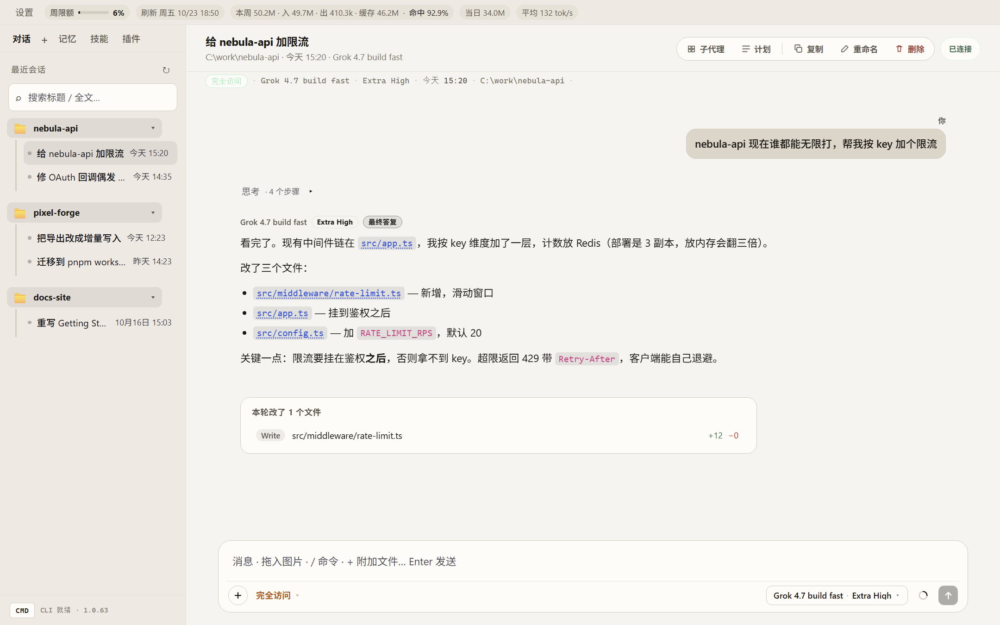
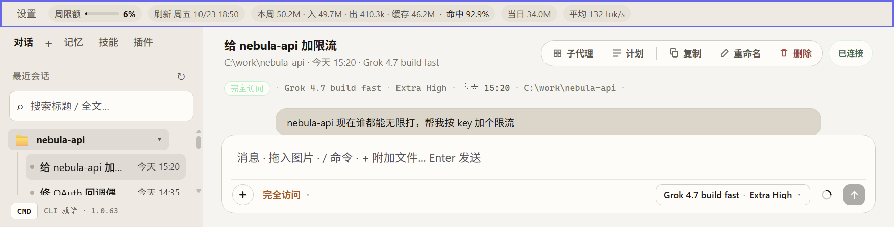
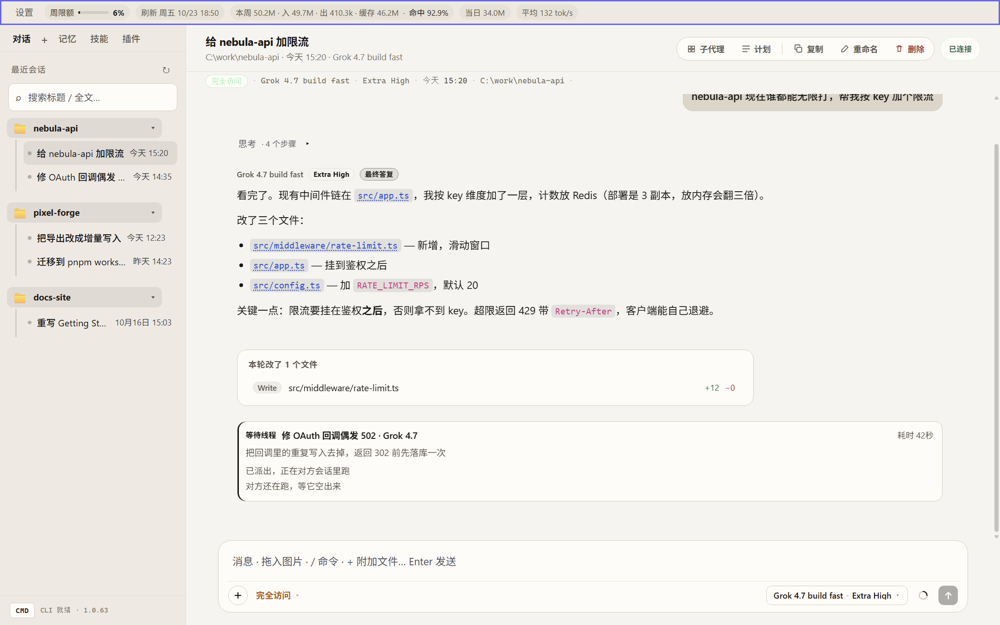
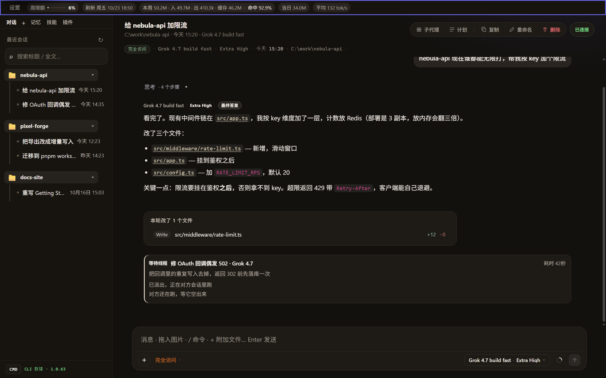

<div align="center">
  
  <h1>Grok Desktop</h1>
  <p>A desktop application for the official Grok CLI.<br/>Multiple sessions, real usage numbers, English and Chinese.</p>
  <p><a href="https://github.com/AvaterXXX/grok-desktop/releases/latest"></a> <a href="https://github.com/AvaterXXX/grok-desktop/releases"></a> <a href="./LICENSE"></a> </p>
  <p><a href="https://github.com/AvaterXXX/grok-desktop/releases/latest"><b>Download</b></a> · <a href="#中文">中文</a> · <a href="#english">English</a> · <a href="./CHANGELOG.md">Changelog</a></p>
</div>



---

# 中文

## 概述

Grok Desktop 是官方 Grok CLI 的图形界面。它在本机已经安装并登录的 `grok` 之上提供一个窗口，不替换后端：登录、额度、模型调用仍然经由 CLI 完成。

> 本文截图由虚构数据渲染，不含真实对话内容。

## 功能

### 多会话

- 多个 CLI 进程并行运行，默认上限 6 个，空闲进程自动回收
- 每个会话独立保存草稿、消息队列、思考过程和执行计划，切换时互不干扰
- 侧边栏按工作目录分组，可拖拽调整会话和分组顺序
- 正在回复的会话会自动排到分组顶部，结束后仍保留位置

### 会话协作

- `/call <会话ID> <任务>` 把任务交给另一个会话执行
- 被调用会话完成后，改动文件列表和回复摘要自动送回发起方审阅
- 支持链式调用，最多 6 层
- 发起方会显示「等待线程」卡片，可点进去查看对方进度

### 输入

- **快速粘贴图片**：直接 `Ctrl+V` 粘贴截图，Windows 上通过系统剪贴板读取，不依赖浏览器的粘贴事件
- **拖放**：把图片、文件或整个文件夹拖进对话区即可附加
- 生成过程中可继续输入，回车加入队列，当前轮结束后自动发送
- 可中断当前轮并立即发送新消息（「引导」）
- 队列中的消息可展开编辑，回车保存，Esc 取消

### 消息操作

鼠标悬停在任意消息上会出现操作按钮：

- **复制**：复制该条消息全文，折叠状态下也复制完整原文
- **分支**：带着上文创建独立的新对话继续，原对话不受影响
- **存入记忆**：把内容收进记忆，之后可作为上下文
- **编辑 / 撤回**：仅对你自己发过的消息显示

### 会话管理

- 右键任意会话可：打开、置顶、重命名、**复制 Markdown**、导出到文件、调用此会话、复制会话 ID / 标题 / 工作目录、在文件夹中显示、归档、删除
- 支持全文搜索，命中处会高亮并定位
- 长会话向上滚动自动加载更早记录，保持阅读位置

### 用量与速度

- 顶栏显示周额度、本周与当日用量、**缓存命中率**
- 显示所有会话的平均生成速度，以及每个会话、每条回复各自的速度
- 速度按 CLI 日志中记录的模型耗时计算，不含工具执行与排队等待
- 每个会话的用量和费用可估算，按模型分别计价

### 外观

- 三种界面语言：简体中文、繁體中文、English，切换立即生效
- 深色与浅色主题，六种配色
- 内置壁纸，也可使用自己的图片并调节压暗程度
- 可选择新旧两版应用图标，任务栏、窗口、托盘和快捷方式一起更换

### 其他

- 内置终端入口，在当前工作区打开 shell，设了代理会自动带上
- 启动时检查 CLI 是否有新版本，可一键更新并重启
- 消息在按下回车时即写入磁盘，进程意外退出后可恢复
- 计划面板与子代理面板并排停靠在侧边，不会遮挡对话

<details>
<summary><b>更多截图</b></summary>
<br/>

**顶栏：额度、缓存命中率、平均速度**



**会话协作**



**深色主题**


</details>

## 安装

1. 安装并登录官方 Grok CLI
2. 从 [Releases](https://github.com/AvaterXXX/grok-desktop/releases/latest) 下载 `Grok-Desktop-0.2.18-Windows-Portable-x64.exe`
3. 运行。程序未签名，SmartScreen 会提示，选择「更多信息」→「仍要运行」

便携版不写入注册表，删除目录即可卸载。

## 构建

需要 Node.js 22.12 或更高版本。

```bash
git clone https://github.com/AvaterXXX/grok-desktop.git
cd grok-desktop
npm install
npm start
```

打包：

```bash
npm run dist:win        # Windows 便携版，输出到 release/
npm run dist:win:dir    # Windows 目录版，无需每次解压
npm run install:win:local # 目录版复制到本机，创建桌面快速启动快捷方式
npm run dist:deb        # Linux
npm run dist:appimage
npm run dist:mac        # macOS dmg + zip
```

日常使用推荐目录版：依次运行 `dist:win:dir` 和 `install:win:local`，然后退出旧版，从桌面“Grok Desktop 快速启动”打开。程序保存在 `%LOCALAPPDATA%\Programs\Grok Desktop`，沿用已有配置和会话。更新时重新执行这两个命令，快捷方式会指向新版本。单文件便携版仍可用于拷贝分发，但每次启动都需要解压。

运行全部检查（lint、格式、类型、单元测试、CSS、性能）：

```bash
npm run check
```

重新生成 README 截图（使用虚构数据，不读取本机会话）：

```bash
npm run shots
```

## 隐私

这个程序不联网上报任何东西。

它没有埋点统计，没有崩溃上报，也不会把你的对话内容、文件路径或使用习惯发送到任何服务器。所有数据都在你自己的电脑上：对话存在 Grok CLI 的会话目录里，界面设置存在本机的配置目录里。

删除一个会话，就是把它从本机删掉，不会同步到云端，也没有云端。

## 已知限制

- Windows 构建未签名，SmartScreen 会拦截
- 仅发布 Windows 构建，Linux 与 macOS 需自行构建
- 依赖官方 CLI，CLI 协议变更可能导致界面部分失效
- macOS 托盘图标使用 Template 模式，跟随系统深浅色

## 许可

本项目由社区维护，非 xAI 官方产品。Grok、xAI 与官方 CLI 归其权利人所有。

MIT License。

---

# English

## Overview

Grok Desktop is a graphical interface for the official Grok CLI. It provides a window on top of the `grok` binary already installed and authenticated on your machine, and does not replace the backend: login, quota and model calls continue to go through the CLI.

> Screenshots in this document are rendered from fabricated data and contain no real conversations.

## Features

### Multiple sessions

- Several CLI processes run in parallel, capped at 6, with idle ones reclaimed automatically
- Each session keeps its own draft, queue, reasoning trace and plan; switching between them does not mix state
- The sidebar groups sessions by working directory and supports drag reordering for both sessions and groups
- A session that is replying moves to the top of its group and stays there afterwards

### Session collaboration

- `/call <session-id> <task>` hands a task to another conversation
- When the callee finishes, its changed-file list and a reply summary are sent back to the caller
- Chained calls are supported, up to 6 levels
- The caller shows a "waiting thread" card you can open to follow the other session

### Input

- **Paste screenshots directly** with `Ctrl+V`; on Windows the image is read from the system clipboard rather than relying on the browser paste event
- **Drag and drop** images, files or whole folders into the conversation
- Keep typing while a reply streams; Enter queues the message for after the current turn
- Interrupt the current turn to send immediately ("guide")
- Queued messages can be expanded for editing; Enter saves, Esc cancels

### Message actions

Hovering a message reveals its actions:

- **Copy** the full text, including when the message is collapsed
- **Branch** into an independent conversation that keeps the context, leaving the original untouched
- **Save to memory** so the content is available as context later
- **Edit / retract**, shown only on messages you sent

### Session management

- Right-click any session for: open, pin, rename, **copy as Markdown**, export to file, call this session, copy session ID / title / working directory, reveal in folder, archive, delete
- Full-text search with highlighted matches and jump-to-result
- Long conversations load earlier messages as you scroll up, keeping your reading position

### Usage and speed

- The top bar shows the weekly quota, weekly and daily token counts, and **cache hit rate**
- Average generation speed is shown overall, per session, and per reply
- Rates come from the model time recorded in the CLI log, excluding tool execution and queueing
- Per-session usage and cost can be estimated, priced per model

### Appearance

- Three interface languages: Simplified Chinese, Traditional Chinese and English, applied without restart
- Dark and light themes with six palettes
- Built-in wallpapers, or your own image with adjustable dimming
- Choose between the current and previous app icon; taskbar, window, tray and shortcut all follow

### Other

- A built-in terminal entry opens a shell in the current workspace, with your proxy applied
- Checks for a newer CLI version at startup and can update and restart in one step
- Messages are written to disk as soon as you press Enter, and can be recovered after an unexpected exit
- Plan and subagent panels dock beside the conversation instead of covering it

<details>
<summary><b>More screenshots</b></summary>
<br/>

**Top bar: quota, cache hit rate, average speed**


**Session collaboration**


**Dark theme**


</details>

## Install

1. Install and sign in to the official Grok CLI
2. Download `Grok-Desktop-0.2.18-Windows-Portable-x64.exe` from [Releases](https://github.com/AvaterXXX/grok-desktop/releases/latest)
3. Run it. The binary is unsigned, so SmartScreen warns: choose **More info → Run anyway**

The portable build writes nothing to the registry; deleting the folder uninstalls it.

## Build

Requires Node.js 22.12 or later.

```bash
git clone https://github.com/AvaterXXX/grok-desktop.git
cd grok-desktop
npm install
npm start
```

Package:

```bash
npm run dist:win        # Windows portable, output in release/
npm run dist:win:dir    # Windows directory build, no extraction on launch
npm run install:win:local # Copy locally and create a desktop shortcut
npm run dist:deb        # Linux
npm run dist:appimage
npm run dist:mac        # macOS dmg + zip
```

For daily use, run `dist:win:dir` followed by `install:win:local`, quit the old version, and open the desktop shortcut **Grok Desktop 快速启动**. The app lives under `%LOCALAPPDATA%\Programs\Grok Desktop` and uses your existing settings and sessions. Repeat the commands to update the shortcut to the new version. The single-file portable build remains available for distribution, but extracts the app on every launch.

Run every check (lint, formatting, types, unit tests, CSS, performance):

```bash
npm run check
```

Regenerate the README screenshots (fabricated data, no local sessions are read):

```bash
npm run shots
```

## Privacy

The application reports nothing over the network.

There is no analytics, no crash reporting, and no server that receives your conversations, file paths or usage habits. Everything stays on your computer: conversations in the Grok CLI session directory, settings in a local config directory.

Deleting a session deletes it from your machine. Nothing is synced anywhere, because there is no cloud.

## Known limitations

- The Windows build is unsigned and SmartScreen will block it
- Only Windows builds are published; Linux and macOS require a local build
- It depends on the official CLI; protocol changes can break parts of the interface
- The macOS tray icon uses template mode and follows the system appearance

## License

Community-maintained, not an official xAI product. Grok, xAI and the official CLI belong to their respective owners.

MIT License.
